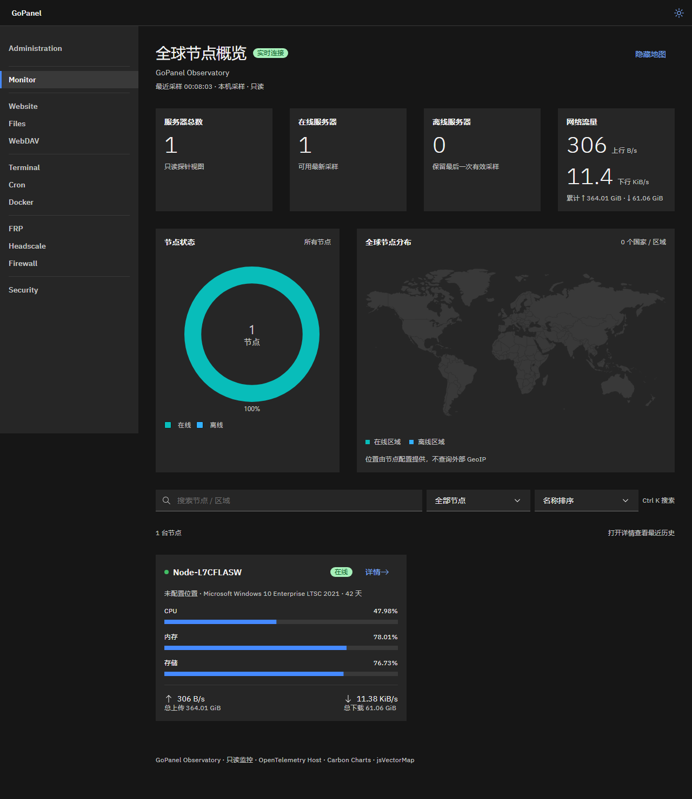
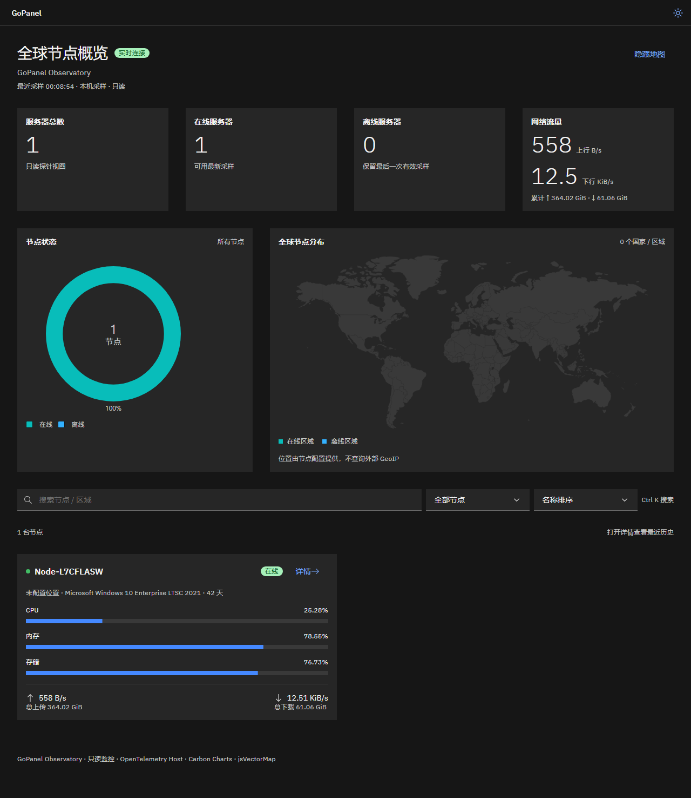
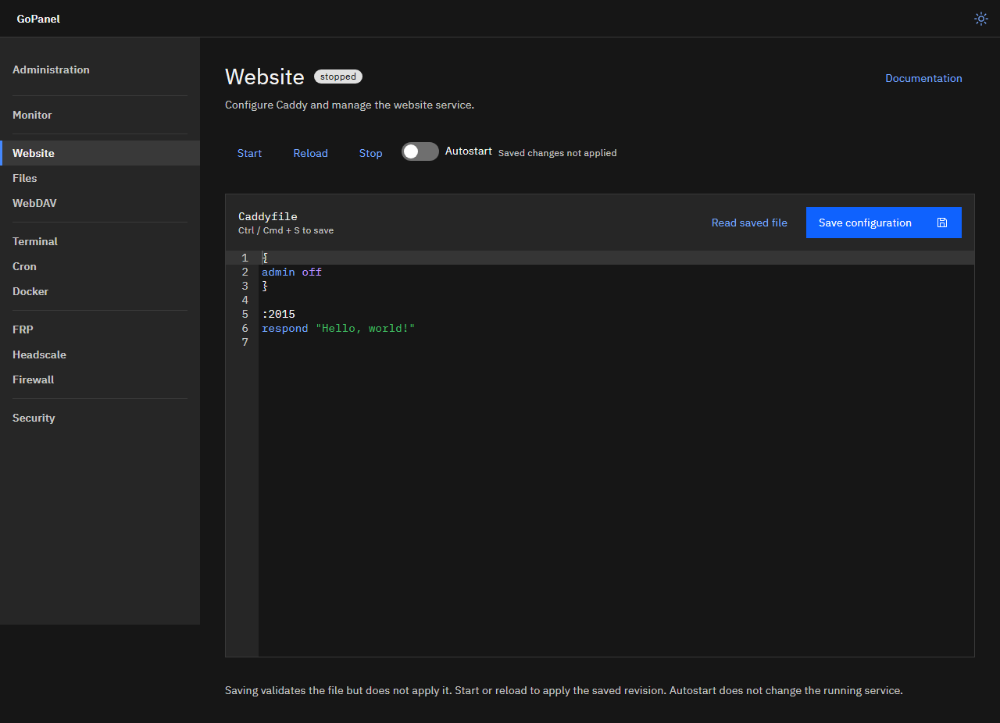

# GoPanel

Manage your server from the browser. One small Go binary, one install command, no database and no build step.




> Entertainment project. Do not use in production.

## Why GoPanel

- **Install in one line.** The installer sets up the service for you on Linux, macOS, and FreeBSD.
- **Everything in one place.** Monitoring, websites, files, a terminal, scheduled tasks, Docker, FRP, and firewall, all in one panel.
- **Single binary.** Go compiles everything into one file. Normal builds need no Node.js or other runtime.
- **Watch many servers.** A read-only observatory shows the status of all your nodes on one page.

## Install

```sh
sh -c "$(curl -fsSL https://raw.githubusercontent.com/BapiGso/gopanel/master/shell/install_gopanel.sh)"
# without curl:
sh -c "$(wget -qO- https://raw.githubusercontent.com/BapiGso/gopanel/master/shell/install_gopanel.sh)"
```

Run the same command again to update. Your settings and data in `/opt/gopanel` are kept.

**Supported:** Linux (systemd or OpenRC), macOS (launchd), and FreeBSD (rc.d). On Windows or other systems, download a binary from the [Releases](https://github.com/BapiGso/gopanel/releases) page and run it manually.

<details>
<summary><strong>Uninstall</strong></summary>

```sh
sh -c "$(curl -fsSL https://raw.githubusercontent.com/BapiGso/gopanel/master/shell/uninstall_gopanel.sh)"
# without curl:
sh -c "$(wget -qO- https://raw.githubusercontent.com/BapiGso/gopanel/master/shell/uninstall_gopanel.sh)"
```

Settings and data are kept by default, and interactive runs ask before deleting `/opt/gopanel`. To delete it without a prompt, run `sh "$script" --purge`.

</details>

## Features

| Module | What you can do |
| --- | --- |
| Monitor | See CPU, memory, disk, and network usage live |
| Website | Edit and run a Caddy config from the browser |
| Files | Browse, upload, and edit server files; WebDAV access |
| Terminal | Open a shell in the browser (WebSSH) |
| Cron | Schedule recurring tasks |
| Docker | Manage containers and images |
| FRP | Manage frps and frpc |
| Firewall | Manage firewall rules |
| Security | Protect the panel entrance |

<table>
  <tr>
    <td></td>
    <td></td>
  </tr>
  <tr>
    <td align="center">Read-only observatory</td>
    <td align="center">Website configuration</td>
  </tr>
</table>

## Monitor many servers

Choose one server as the **master** and list the other servers in its `gopanel_monitor.json` `peers` field. Give every server the same monitoring `key`. The master pulls read-only snapshots from the other servers. No monitoring database is needed. See [monitoring and probe setup](docs/monitoring.md) for details.

## For developers

```sh
go build -o gopanel .
```

- **HTTP API:** a versioned JSON API at `/api/v1`, with an OpenAPI 3.1 spec at `/api/v1/openapi.json`. See the [HTTP API guide](docs/http-api.md).
- **Configuration:** set `GOPANEL_CONFIG_DIR` to choose where settings are stored. See [configuration storage](docs/configuration.md).
- **Frontend:** Go templates, Alpine.js, and IBM Carbon, all embedded with no npm build. See [frontend architecture](docs/carbon-ui.md). Run frontend tests with `node --test frontend/observatory.test.cjs`.
- **Carbon assets:** to re-download the embedded Carbon components, see [vendored asset sources](assets/vendor/README.md).

## Roadmap

- headscale ([juanfont/headscale](https://github.com/juanfont/headscale))

## Links

- [Releases](https://github.com/BapiGso/gopanel/releases)
- [Issues](https://github.com/BapiGso/gopanel/issues)
- [License](https://github.com/BapiGso/gopanel/blob/master/LICENSE) (Apache-2.0)
