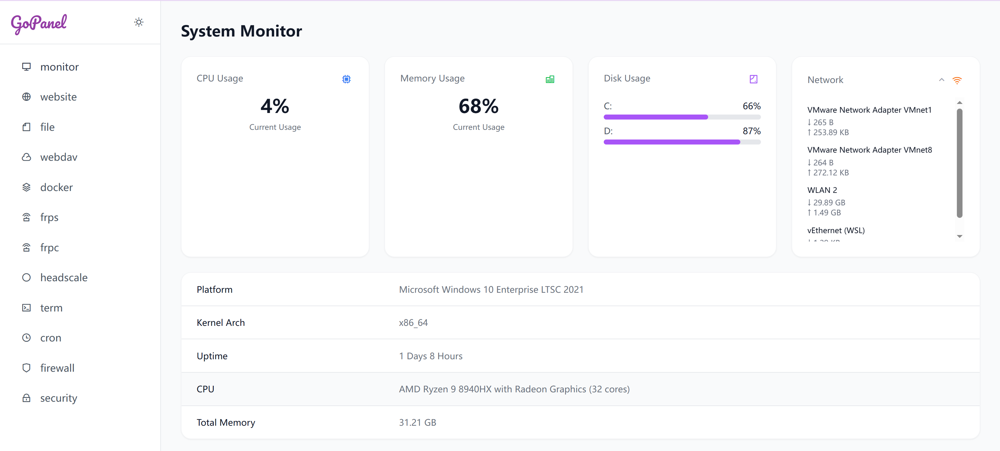

# gopanel



A lightweight Go-based management panel with simple deployment and practical built-in tools.


> Entertainment project. Do not use in production.

## Quick Start

<details open>
<summary><strong>Install</strong></summary>

With curl:

```sh
script=$(mktemp) &&
curl -fL https://raw.githubusercontent.com/BapiGso/gopanel/master/shell/install_gopanel.sh -o "$script" &&
sh "$script"
```

Or with wget:

```sh
script=$(mktemp) &&
wget -O "$script" https://raw.githubusercontent.com/BapiGso/gopanel/master/shell/install_gopanel.sh &&
sh "$script"
```

The scripts use POSIX `sh`, not Bash. Run as root, or with a configured `sudo` or `doas`; only one of curl/wget is needed. Missing dependencies are reported before installation. On macOS, the built-in curl is sufficient for downloading.

| Operating system | Service manager | Prebuilt architectures |
| ---------------- | --------------- | ---------------------- |
| Linux | systemd or OpenRC | amd64, arm64, ARMv7, s390x, riscv64 |
| macOS | launchd | amd64, arm64 |
| FreeBSD | rc.d / daemon | amd64 |

Linux detection checks the running init system, not just installed commands. SysVinit, runit, s6, containers without a supported init, and Windows are not supported by these service-installation scripts. MIPS and other unlisted OS/architecture combinations require a manual build. Download an appropriate binary from the [Releases](https://github.com/BapiGso/gopanel/releases) page for manual deployment, including Windows.

Run the installer again to update. It also refreshes service definitions and preserves configuration/data in `/opt/gopanel`. Downloads finish before stopping the old service; failed updates restore the previous binary and attempt to restart it if it was running. Success is reported only after the service reaches the running state.

</details>

<details>
<summary><strong>Uninstall</strong></summary>

With curl:

```sh
script=$(mktemp) &&
curl -fL https://raw.githubusercontent.com/BapiGso/gopanel/master/shell/uninstall_gopanel.sh -o "$script" &&
sh "$script"
```

Or with wget:

```sh
script=$(mktemp) &&
wget -O "$script" https://raw.githubusercontent.com/BapiGso/gopanel/master/shell/uninstall_gopanel.sh &&
sh "$script"
```

Uninstall stops and disables the service before removing its files. Configuration and data are retained by default; interactive runs ask before deleting `/opt/gopanel`. For explicit non-interactive deletion, use `sh "$script" --purge` instead of `sh "$script"`.

</details>

## Features

| Module               | Description                          | Dependency                                                     |
| -------------------- | ------------------------------------ | -------------------------------------------------------------- |
| Security Entrance    | Panel security entry and protection  | Built-in                                                       |
| Server Monitor       | Basic server monitoring              | [shirou/gopsutil](https://github.com/shirou/gopsutil)          |
| Cron                 | Scheduled task management            | [go-co-op/gocron](https://github.com/go-co-op/gocron)          |
| WebSSH               | Terminal access in the browser       | [golang.org/x/crypto/ssh](https://pkg.go.dev/golang.org/x/crypto/ssh) |
| WebDAV               | WebDAV server support                | [golang.org/x/net/webdav](https://pkg.go.dev/golang.org/x/net/webdav) |
| File Editor          | Web file manager and editor          | Built-in                                                       |
| Caddy Manage         | Caddy service management             | [caddyserver/caddy](https://github.com/caddyserver/caddy)      |
| FRPS Manage          | frps management                      | [fatedier/frp](https://github.com/fatedier/frp)                |
| FRPC Manage          | frpc management                      | [fatedier/frp](https://github.com/fatedier/frp)                |
| Docker Manage        | Docker management                    | [docker/docker](https://github.com/docker/docker)              |
| Firewall             | Firewall management                  | [google/nftables](https://github.com/google/nftables)          |
| UnblockNeteaseMusic  | Currently disabled                   | [cnsilvan/UnblockNeteaseMusic](https://github.com/cnsilvan/UnblockNeteaseMusic) |

## Read-Only Observatory

The monitor now supports a global map, multi-node lists, tags, search, live updates, and bounded in-memory history. `/status/monitor` is a sanitized read-only dashboard built with Tailwind + daisyUI and locally bundled jsVectorMap assets.

For new deployments, manually select a master and put the other servers' IPs in its `gopanel_monitor.json` `peers` list, with one shared monitoring `key`. Each probe needs only the same `key`; roles and stable node IDs are automatic. The master pulls signed, read-only snapshots from TCP port 9555, without peer discovery, elections, a monitoring database, or Raft. Probe-only processes expose no administration routes. Legacy candidate/push configurations remain supported. See [monitoring and probe setup](docs/monitoring.md) for examples and network/security boundaries.

The dashboard contains only real metrics, with no preview/demo mode. Tailwind + daisyUI styles are precompiled and embedded; browsers do not run a Tailwind compiler. Updates reuse node objects and map markers, hidden tabs stop streaming, and node lists render at most 50 rows per page while the map and totals cover the entire fleet. To rebuild styles after frontend changes, run `npm ci --ignore-scripts` and `npm run build:monitor`; `npm run test:monitor` runs the frontend regression tests. Normal Go builds need no Node.js.

## Agent HTTP API

The web UI and agents share a versioned JSON management API at `/api/v1`. Resource IDs live in paths, writes use typed JSON bodies, and lifecycle operations have explicit endpoints. The legacy page URLs no longer dispatch mutations through query parameters.

Authenticate with the existing panel session cookie or HTTP Basic credentials over HTTPS, then fetch `/api/v1/openapi.json` for the generated OpenAPI 3.1 contract. Native Caddy/FRP configuration is retained; saving and applying configuration are separate operations.

See the [HTTP API guide](docs/http-api.md) for endpoints, examples, concurrency handling, and platform limitations.

Panel settings use a typed, revision-checked JSON file store without a panel database. Set `GOPANEL_CONFIG_DIR` to select the configuration directory; otherwise the startup working directory is retained for compatibility. Existing JSON settings are preserved and migrated on the next successful save. See [configuration storage](docs/configuration.md) for initialization, file layout, and safety guarantees.

## Roadmap

<details>
<summary><strong>Planned / TODO</strong></summary>

- headscale ([juanfont/headscale](https://github.com/juanfont/headscale))

</details>

## Project Links

- [Releases](https://github.com/BapiGso/gopanel/releases)
- [Issues](https://github.com/BapiGso/gopanel/issues)
- [License](https://github.com/BapiGso/gopanel/blob/master/LICENSE)

## License

Released under the [Apache License](https://github.com/BapiGso/gopanel/blob/master/LICENSE).

## Acknowledgments

Thanks to the Go community and all open-source contributors who made this project possible.
